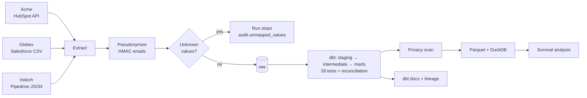
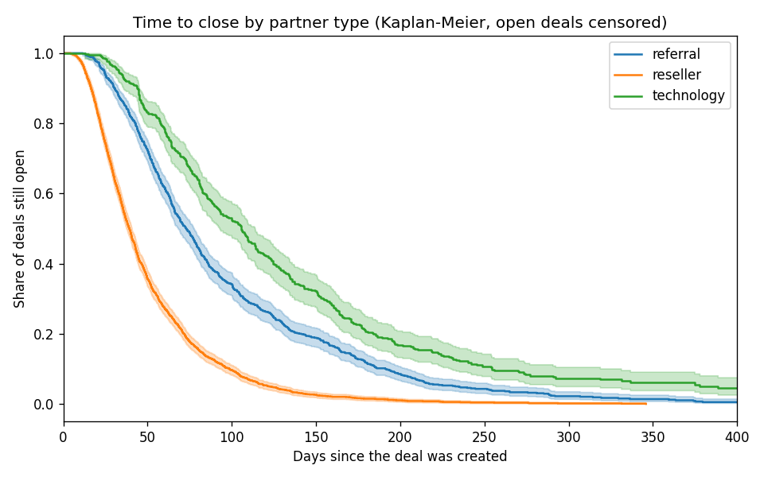

# PartnerHub Data Platform


> Portfolio project: a multi-tenant data pipeline for a B2B SaaS that manages **partner relationships** (PRM).
> Three customers send their partner data from **three different CRMs**. The platform turns them into **one canonical model** that can be trusted, is anonymized, and is tested at every step.
> *All companies and data are fictional and generated.*

## The problem

Every tenant describes the same reality in its own words:

| | Acme | Globex | Initech |
|---|---|---|---|
| CRM | HubSpot | Salesforce | Pipedrive |
| Format | Paginated REST API | CSV export | JSON export |
| A won deal | `closedwon` | `Closed Won` | `status = won` |
| An open deal in negotiation | `contractsent` | `Negotiation/Review` | `status = open, stage_id = 4` |
| A reseller | `Reseller` | `VAR` | `reseller` |
| Côte d'Ivoire | `Ivory Coast` | `Côte d'Ivoire` | `CIV` |
| Currency | USD | EUR | XOF |
| Close date of an open deal | empty | **filled with the expected date** | empty |

The last row is a trap: a naive pipeline would treat Salesforce's *expected* close date as a real one.

## Architecture



## What this project demonstrates

- **Canonical modelling across tenants**: mapping tables (dbt seeds) turn each tenant's vocabulary into canonical stages, partner types, ISO countries and USD amounts.
- **Nothing is dropped silently.** Before loading, every stage, type and country is checked against the mappings. An unknown value **stops the run** and is logged in `audit.unmapped_values`. A new spelling cannot quietly make revenue disappear.
- **Reconciliation**: row counts and amounts are computed from the sources, then compared with the warehouse by a dbt test, tenant by tenant.
- **Privacy by design**:
  - emails are replaced by a keyed hash (HMAC-SHA256) **before** they reach the database, and contact names are dropped;
  - the salt stays outside the warehouse;
  - a final scan checks every text column for anything that looks like an email.
- **Tenant isolation**: Postgres row-level security on every mart. The `analyst` role sees one tenant at a time and has no access to raw data.
- **Tested, reviewable code**: 14 pytest unit tests, 28 dbt tests, and GitHub Actions runs the full pipeline on every push.
- **Analysis datasets**: marts are exported to Parquet and queried with DuckDB.
- **Statistics with care**:
  - *distribution before averages*: the mean deal is about 1.6× the median, and the top 10 % of deals bring about 37 % of revenue;
  - *censoring*: time to close is estimated with Kaplan-Meier, because the median of closed deals alone ignores the slow ones still open.

## Results (generated data)

| Partner type | Deals | Still open | Median days, closed deals only | Median days, Kaplan-Meier |
|---|---|---|---|---|
| reseller | 1,882 | 106 | 38.0 | 39.3 |
| referral | 888 | 80 | 69.3 | 73.0 |
| technology | 430 | 58 | 94.2 | **105.6** |

The naive median underestimates technology partners' sales cycle by about 11 days.



## Run it

You need Docker Desktop.

```bash
git clone https://github.com/Isac9/partnerhub-data-platform.git
cd partnerhub-data-platform
docker compose up -d postgres crm-api docs
docker compose run --rm pipeline
```

| What | Where |
|---|---|
| Data catalog and lineage (dbt docs) | http://localhost:8082 |
| Mock HubSpot API | http://localhost:8010/docs |
| Postgres | `localhost:5435`, user `partnerhub` / `partnerhub` (or `analyst` / `analyst`) |

### Try the safety nets

```bash
# 1. A tenant starts writing "Closed-Won": the run stops and says why
docker compose run --rm pipeline python -m partnerhub.generate --inject-anomaly
docker compose run --rm pipeline

# 2. Tenant isolation: the analyst sees nothing until a tenant is chosen
docker compose exec postgres psql -U analyst -d partnerhub -c "select count(*) from marts.fct_deals"
docker compose exec postgres psql -U analyst -d partnerhub -c "set app.tenant_id='acme'; select tenant_id, count(*) from marts.fct_deals group by 1"

# 3. Unit tests
docker compose run --rm pipeline pytest -q
```

## Project layout

```
crm_api/            mock HubSpot API (FastAPI, cursor pagination)
pipeline/partnerhub/
  generate.py       fake data for the 3 tenants
  ingest.py         extract + load raw + source totals
  privacy.py        pseudonymization + email scan
  validate.py       unknown values stop the run
  export.py         Parquet + DuckDB
  survival.py       Kaplan-Meier time to close
  run_all.py        the whole pipeline, step by step
dbt/
  seeds/            mappings, fx rates, tenants
  models/           staging → intermediate → marts
  tests/            reconciliation and business rules
tests/              pytest
sql/init.sql        schemas, audit tables, analyst role
```
